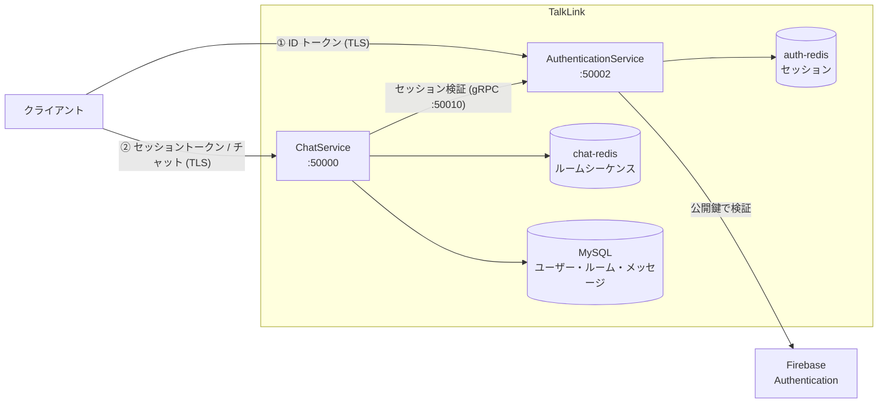

# TalkLink

TalkLink は C++17 で実装したリアルタイムチャットのサーバーです。
TLS 上の TCP で JSON メッセージをやり取りし、認証（AuthenticationService）とチャット（ChatService）を別々のサービスとして動かします。

このリポジトリにはサーバー側のコードのみが含まれます。

## 主な機能

- Firebase Authentication の ID トークンによるログインと、独自のセッショントークンの発行
- サインアップ / サインイン / サインアウト
- 1 対 1・グループのチャットルーム（作成・参加・退出）
- メッセージの配信と受信確認（ACK）、配信できなかった場合の再送
- オフライン中に届いたメッセージの取得と、メッセージの同期
- ユーザー検索
- ハートビートによる接続監視、過負荷時の接続制御
- TLS 証明書の自動再読み込み

## 構成



### ログインの流れ

1. クライアントは Firebase Authentication でログインし、ID トークン（JWT）を取得します。
2. クライアントは AuthenticationService に ID トークンを送ります（`AUTHENTICATION_REQUEST`）。AuthenticationService は Firebase の公開鍵で署名・発行元・有効期限を検証し、セッショントークンを発行します。セッションは auth-redis に、トークンのハッシュをキーとして保存されます。
3. クライアントはセッショントークンを付けて ChatService に `SESSION_REQUEST`（`SIGNUP` / `SIGNIN` / `SIGNOUT`）を送ります。
4. ChatService は gRPC（`Proto/session.proto` の `SessionService`）で AuthenticationService にセッションを問い合わせます。ChatService は auth-redis に直接アクセスしません。
5. `SIGNIN` は MySQL にユーザー登録がある場合だけ成功します。

`SESSION_RESPONSE` の `error_message` には、次のエラーコードが入ることがあります。

| エラーコード | 意味 | クライアントの扱い |
|---|---|---|
| `USER_NOT_REGISTERED` | Firebase では認証済みだが、TalkLink に未登録 | SIGNUP 画面へ |
| `USER_ALREADY_REGISTERED` | 登録済みのユーザーが SIGNUP した | SIGNIN し直す |
| `USER_LOOKUP_FAILED` | DB 障害などで登録状態を確認できなかった | 画面遷移せずに再試行 |

### 各サービスの層構成

ChatService と AuthenticationService は、どちらも次の層に分かれています。

```
<Service>/
├─ include/, src/
│  ├─ <Service>Facade      … ネットワーク処理（accept・受信・送信）
│  ├─ Application/
│  │  ├─ UseCases/          … 機能ごとの処理（Chat, Chatroom, Sync, UserSession, Authentication）
│  │  ├─ Runtime/           … サーバーの実行基盤（起動、リクエスト振り分け、タスク管理、監視、送信）
│  │  ├─ Interfaces/        … Application 層が外部に求めるインターフェース
│  │  └─ DTO/
│  ├─ Domain/
│  │  ├─ Entity/            … 識別子と状態を持つもの（User）
│  │  ├─ Messages/          … プロトコルのメッセージ
│  │  ├─ DTO/
│  │  └─ Interfaces/        … リポジトリなどのインターフェース
│  └─ Infrastructure/       … MySQL・Redis・gRPC・Firebase などの実装
```

## 技術スタック

| 分類 | 使用技術 |
|---|---|
| 言語・ビルド | C++17, CMake, Ninja |
| 通信 | TCP + TLS（OpenSSL）, epoll, gRPC / Protocol Buffers（サービス間） |
| データ | MySQL 8.0（Flyway でマイグレーション）, Redis |
| 認証 | Firebase Authentication, jwt-cpp |
| ライブラリ | nlohmann/json, spdlog, hiredis, ulid |
| テスト | GoogleTest |
| 実行環境 | Docker, Docker Compose, GitHub Container Registry |

## ディレクトリ構成

| パス | 内容 |
|---|---|
| `ChatService/` | チャットサービス |
| `AuthenticationService/` | 認証サービス |
| `CommonLib/` | 両サービスで共有するライブラリ（ソケット、TLS、スレッドプール、メッセージの基底クラス、DB ヘルパーなど） |
| `Proto/` | サービス間 gRPC API の定義 |
| `Tests/` | GoogleTest によるテスト |
| `ThirdParty/` | 同梱しているサードパーティーライブラリ |
| `config/` | 各サービス・MySQL の設定ファイル |
| `mysql/` | MySQL の初期化スクリプトと Flyway のマイグレーション |
| `Deploy/` | イメージのビルドと公開、MySQL のバックアップ、証明書の配置スクリプト |
| `tool/` | 開発用スクリプト（`.env` の作成、開発用証明書の生成） |

## 開発環境で動かす

必要なもの：Docker と Docker Compose

```bash
# 1. .env を作成する（.env.example をコピーします。パスワードは必ず変更してください）
./tool/setup_env.sh

# 2. 開発用の自己署名証明書を作成する（certs/chat-service, certs/auth-service）
./tool/generate-dev-cert.sh

# 3. ビルドして起動する
docker compose up --build
```

Docker のビルド中に、各サービスのテストも実行されます。テストが失敗するとイメージは作られません。

### ポート（開発環境）

| ポート | 用途 |
|---|---|
| 50000/tcp | ChatService（TLS） |
| 50002/tcp | AuthenticationService（TLS） |
| 50001/udp, 50003/udp | 各サービスのマルチキャスト送信 |
| 50010/tcp | AuthenticationService の gRPC（コンテナ内部のネットワークのみ。ホストには公開しない） |
| 3306/tcp | MySQL |
| 6379/tcp, 6380/tcp | chat-redis, auth-redis |

### 環境変数

`.env` で設定します。一覧は [.env.example](.env.example) を参照してください。

| 変数 | 内容 |
|---|---|
| `MYSQL_ROOT_PASSWORD`, `MYSQL_USER`, `MYSQL_PASSWORD`, `MYSQL_DATABASE` | MySQL の接続情報 |
| `MYSQL_BACKUP_PASSWORD` | バックアップ用 MySQL ユーザーのパスワード（必須） |
| `DB_HOST`, `DB_PORT` | ChatService から見た MySQL の接続先 |
| `CHAT_SERVICE_MACHINE_ID` | メッセージ ID の生成に使うマシン ID。複数のインスタンスで動かす場合は、インスタンスごとに一意な値にする |
| `CHAT_REDIS_HOST`, `AUTH_REDIS_HOST`, `REDIS_PORT` | 各サービス専用の Redis の接続先 |

## ローカルでビルドしてテストする

Docker を使わずにビルドする場合は、[ChatService/Dockerfile](ChatService/Dockerfile) に書かれているパッケージ（OpenSSL、hiredis、gRPC、Protocol Buffers など）をインストールしてください。

```bash
cmake -S . -B build -G Ninja \
    -DBUILD_CHAT_SERVICE=ON \
    -DBUILD_AUTH_SERVICE=ON \
    -DBUILD_TESTS=ON \
    -DWITH_MYSQL=ON \
    -DCMAKE_POLICY_VERSION_MINIMUM=3.5
cmake --build build

# テストを実行する（domain / application / auth の各ラベル）
ctest --test-dir build -L "domain|application|auth" --output-on-failure
```

`-DWITH_MYSQL=ON` を付けないと、MySQL Connector がリンクされず、ChatService の実行ファイルのリンクに失敗します。

## 本番環境へのデプロイ

1. `CMakeLists.txt` の `project(TalkLink VERSION x.y.z ...)` を更新してコミットします。
2. イメージをビルドし、GitHub Container Registry に push します。スクリプトは、作業ツリーがクリーンであることと、引数と `CMakeLists.txt` のバージョンが一致することを確認してから、イメージの push と `vx.y.z` タグの push を行います。

   ```bash
   ./Deploy/ImageBuildPush.sh x.y.z
   ```

3. 本番サーバーで `TALKLINK_VERSION` を設定し、[compose.prod.yml](compose.prod.yml) で起動します。

   ```bash
   docker compose -f compose.prod.yml up -d --remove-orphans
   ```

本番の TLS 証明書は Let's Encrypt（certbot）で取得し、[Deploy/certbot/cert-deploy.sh](Deploy/certbot/cert-deploy.sh) で `certs/chat-service`・`certs/auth-service` に配置します。各サービスは証明書の更新を検知して自動で再読み込みします。

MySQL のバックアップとリストアには [Deploy/backup/](Deploy/backup/) のスクリプトを使います。

## 設計ドキュメント

- [クラス図](ChatService/diagram/class-diagram.md)
- [ログインのシーケンス図](ChatService/diagram/sequence_login_diagram.md)
- [1 対 1 チャットのシーケンス図](ChatService/diagram/sequence_P2P_chat_diagram.md)

## 今後の予定

- GitHub Actions による CI/CD
- サービス間 gRPC 通信の mTLS 化と、各サービスのヘルスチェック
- 画像送信用の Media サービス（S3 互換のオブジェクトストレージへ署名付き URL で直接アップロード）
- プッシュ通知用の Notification サービス
